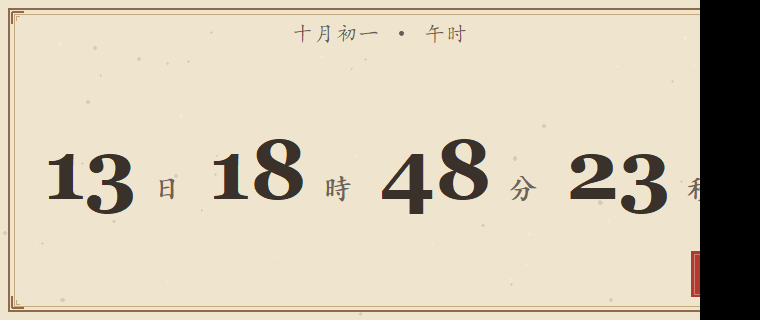
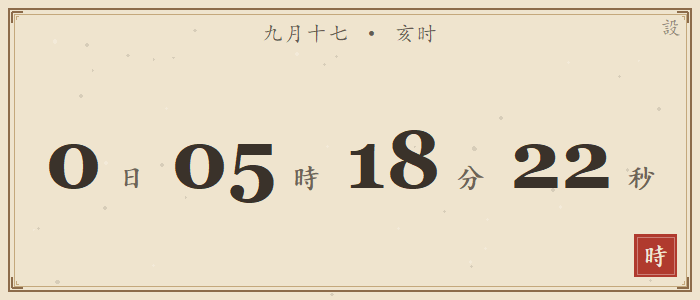

# 古风倒计时

一个常驻桌面的倒计时小工具。宣纸底、古铜框、朱砂印，剩余时间越少，颜色越紧迫。

纯 Python 标准库 + Tkinter 实现，**零第三方依赖**；发布包是打包好的单文件 exe，没有 Python 也能直接跑。

## 效果

| 常态 | 紧急 |
|---|---|
|  |  |
| **入夜** | **归零** |
|  |  |

更多截图见 `预览图/` 目录（设置面板、传书设置与寄出记录）。

## 功能特性

- **桌面挂件形态** —— 不占任务栏，默认置顶；可拖动、可 8 方向自由缩放，数字字号自动适配
- **设置面板可调大小** —— 右下角拖动改尺寸，关掉后记住；拖乱了点标题栏「⤢」回到自动大小。
  面板缩窄时长句自动折行，内容放不下时右侧有细滚动条
- **任意分隔符的时间输入** —— `10.1`、`10月1日11:30`、`10-1 11:30`、`10 1 2 32` 都能认；只认数字，其它符号一律当间隔，写错了会明确告诉你错在哪
- **一键 +30 天** —— 右键菜单第一项、设置面板各有一个按钮，点一下倒计时顺延 30 天：没过期在原时刻上加，过期了从现在起算；归零那一刻目标会被钉成带年份的写法，**重启多少次都停在「時辰已到」**，不会再变成三百多天
- **颜色随紧迫度变化** —— 4 档配色规则（竹青 → 琥珀 → 朱砂 → 入夜），最后 12 小时连底色一起换成墨黑；档位、颜色都能改
- **传书 · 邮件提醒** —— 剩余时间跨过档位时自动寄一封邮件；失败退避重试、关机期间错过的开机补寄、同档只寄一次
- **发信独立成进程** —— 主程序全程不加载 `smtplib`/`email`，加邮件提醒常驻占用零增加
- **定时关机** —— 两个触发来源，**谁先到谁关**：① 远程设置那份配置文件里写的时刻（`shutdown.at`，写法同目标时刻，如 `2026.10.20.18.00`）；② 倒计时目标归零那一刻（默认开，可关）。两个时刻始终各自独立，改配置文件绝不会动你设的倒计时。到点先弹窗问一句（默认 60 秒，不点才关），关不掉每分钟自动重试直到关成；程序没运行期间错过的时刻绝不补关（v1.11 起不再有「单独填一个网址去取关机时刻」那条路，统一从远程设置拿）
- **窗口盯守** —— 定时查看某扇窗口还在不在（默认 30 分钟一次），不见了先弹窗问一句「是你自己关的吗」，无人应答就自动寄信；窗口下次出现时自动接着盯。面板上有「试一遍」按钮，可以当场演一遍并真发一封标注为「演练」的信
- **极低占用** —— 实测 CPU 0.014%、内存约 38 MB、GPU 0%，每秒刷新仅 2.2 ms
- **设置是一个看得见的文件** —— 全部数据（配置/授权码/履历）收在 `%USERPROFILE%\.古风倒计时\设置.json` 一个文件里，记事本就能看能改能备份；程序文件夹里永远只有程序本身。**邮箱授权码经 Windows DPAPI 加密**，拷到别的机器解不开
- **多机共用设置** —— 一台机器配好，导出成一份 `共用设置.json`（导出时可一项一项挑：授权码、远程设置、窗口盯守……全都能带上），U 盘拷到各台机器上「从文件导入」即生效；勾上「敏感信息脱敏」后凭据一律打码，文件可以放心发公开场合
- **远程设置** —— 把那份 `共用设置.json` 放到一个网址上，各台机器自己定时去取（启动后 20 秒、之后每 6 小时），认证支持 Basic / Bearer / 自定义请求头 / 无。**密码类永不参与同步**，远端也改不了"下次去哪儿取"和开机自启
- **恢复出厂 / 一键清理** —— 设置面板一键清空数据，卸载送人无残留
- **在线升级** —— 设置面板点「检查更新」自动换新（sha256 校验、失败回滚、数据无损）；另有 `selfupdate` 命令行支持多台机器批量升级
- **单实例** —— 重复双击只会把已经开着的窗口拉回屏幕，不会多开
- **开机自动运行** —— 设置面板勾选即可；写入当前用户启动项（这是唯一用到注册表的地方，Windows 的规矩），无需管理员权限，勾选状态始终以实况为准

## 快速开始

### 打包版（推荐，免安装）

1. 到 [Releases](https://github.com/chengmoya/ancient-countdown/releases) 页下载发布包 zip（约 11 MB），解压
2. 双击 `古风倒计时.exe` 运行，窗口出现在屏幕右上方（首次启动慢两三秒是自解压，正常）
3. 双击窗口（或右键 → 设置）填目标时刻，例如 `10.1`

### 源码版

需要 Windows + Python 3.9 及以上：

- 双击 `启动倒计时.bat`，或命令行运行 `pythonw AncientCountdown.pyw`

## 目录结构

| 文件 | 说明 |
|---|---|
| `AncientCountdown.pyw` | 主程序 |
| `mailer.pyw` | 传书使者 —— 独立发信小程序，被主程序按需唤起，发完即退 |
| `启动倒计时.bat` | 源码版启动入口 |
| `发行说明.txt` | 下一版要说给用户听的更新说明，发版前改这里 |
| `使用说明.md` | 完整使用文档 |
| `发布/` | 本地打包产物（exe 与发布包 zip 不入库，正式下载走 [Releases](https://github.com/chengmoya/ancient-countdown/releases)；`默认配置.json` 由 `生成默认配置.py` 在打包时从 `DEFAULT_CONFIG` 现生成，随包一起提交留档） |

> 程序**不会**在文件夹里生成任何配置文件 —— 目标时刻、窗口位置、传书设置、
> **邮箱授权码**、寄信履历全部存在用户目录下的
> `%USERPROFILE%\.古风倒计时\设置.json`（v1.8 起，从注册表搬出来的）。
> 所以这个文件夹里永远只有程序本身。授权码在该文件里是加密的，拷到别的机器
> 也解不开；用设置面板底部的「恢复出厂」可以一键清空。

## 平台

仅支持 Windows（使用了 Win32 互斥锁、GDI 绘制与输入法消息）。

## 完整文档

时间格式、颜色规则、窗口操作、传书设置、常见问题，见 [使用说明.md](使用说明.md)。
